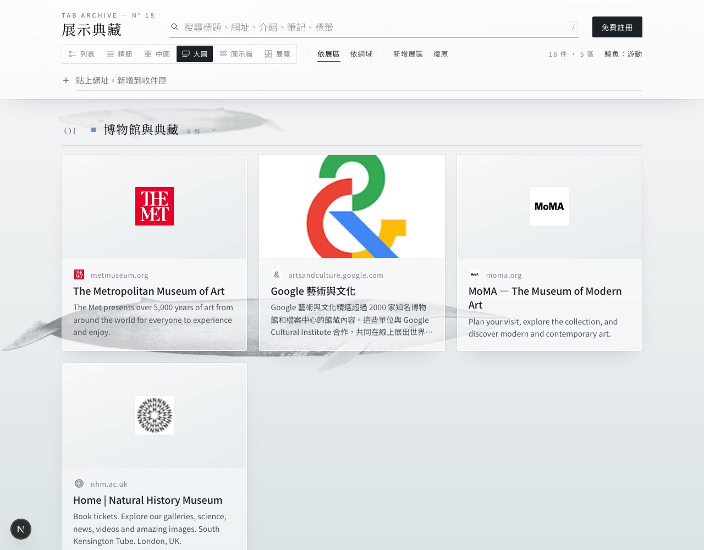
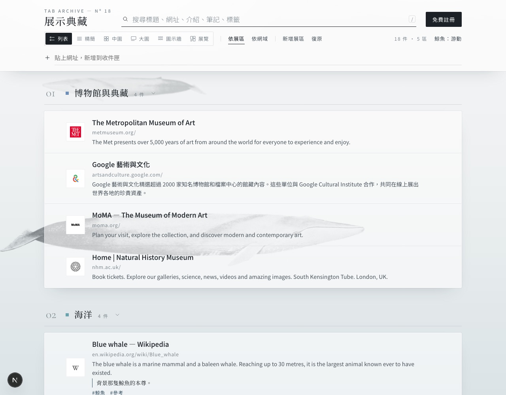
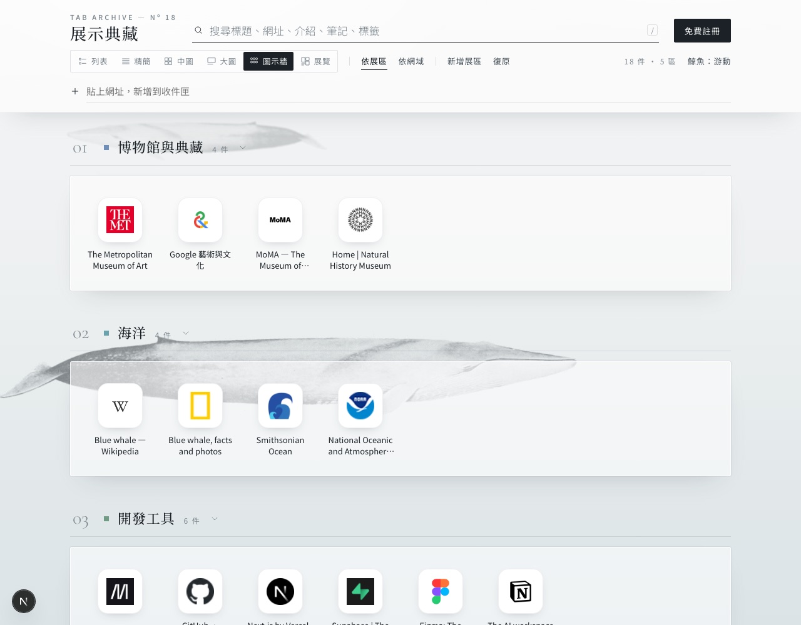

# Tab Archive

**A quiet, museum-style archive for your browser tabs.** Too many open tabs slow the browser down. Tab Archive saves every tab in one click, sorts them by your tab groups, and keeps them findable on your computer, phone and tablet.

**Live site: https://tab-archive.vercel.app** · [Try the demo](https://tab-archive.vercel.app/demo) (no sign-up)

[](https://github.com/YA-CIAO-LIANG/tab-archive/actions/workflows/ci.yml)


## Features

- **Save all tabs in one click.** A Brave / Chrome / Edge extension sends your open tabs to the archive and can close them afterwards. Pinned tabs stay open.
- **Sorted by tab group.** Each browser tab group becomes a room with the same name and color. Ungrouped tabs go to the Inbox.
- **Six ways to view:** List, Compact, Medium, Large, Icon wall and Gallery.
- **Previews and large icons.** Each page's title, description, preview image and high-resolution icon are fetched automatically.
- **Organize.** Search, notes, tags, drag between rooms, bulk move / open / delete, and undo (⌘Z).
- **Accounts.** Sign in with Google, or sign up with email and password (with password reset). Each account sees only its own data.
- **Phone and tablet.** Responsive layout, installable to the home screen. On Android, share a link straight into the archive.
- **Your data stays yours.** Export and import JSON anytime. Deleting your account deletes everything.

| Large                                     | Gallery                                       |
| ----------------------------------------- | --------------------------------------------- |
|  |  |
| **List**                                  | **Icon wall**                                 |
|    |  |

## Install the extension

1. Sign in, open **Account**, and download the extension zip. Unzip it. You can also use the `extension/` folder in this repo.
2. Go to `brave://extensions` (or `chrome://extensions`), turn on **Developer mode**, click **Load unpacked**, and choose the folder.
3. Click the extension icon, then **Save all tabs**. Shortcut: `Alt+Shift+S`.

The extension saves to https://tab-archive.vercel.app by default. If you host your own copy, change the address under **Settings** in the extension.

## How it works

| Part            | Technology                                                             |
| --------------- | ---------------------------------------------------------------------- |
| Web app         | Next.js 16 (App Router), React 19, TypeScript                          |
| Accounts & data | Firebase Authentication (Google, email) and Cloud Firestore, free plan |
| Hosting         | Vercel, free plan                                                      |
| Extension       | Chrome Manifest V3 (`extension/`)                                      |

The extension needs no API key. It opens `/app/capture#tabs=…` with the tab list after the `#`. The page reads the list and saves it to the account signed in on the site. Everything after `#` stays in the browser and is never sent to a server.

Data lives at `users/{uid}/groups` and `users/{uid}/links` in Firestore. The rules in `firestore.rules` allow each user to read and write only their own documents. Design decisions are recorded in [`docs/decisions.md`](docs/decisions.md).

## Develop locally

```bash
npm install
npm run dev        # http://localhost:3000 — demo at /demo
```

The Firebase web config is in `lib/firebase-config.ts`. These values are public by design, so no environment variables are needed.

Run all checks (CI runs the same):

```bash
npm run lint && npm run format:check && npm run typecheck && npm test && npm run build
```

## Self-host

1. Create a project in the [Firebase console](https://console.firebase.google.com) (the free Spark plan is enough). Add a web app and put its config in `lib/firebase-config.ts`.
2. **Authentication → Sign-in method:** enable **Email/Password** and **Google**. Under **Settings → Authorized domains**, add your site's domain.
3. Create a Firestore database and deploy the rules:
   `npx firebase-tools deploy --only firestore:rules --project <project-id>`
4. Import this repo on [Vercel](https://vercel.com) and deploy. No settings needed.

## Privacy

- Each account can read and write only its own data (`firestore.rules`).
- To build previews, the server fetches only the `<head>` of public pages. Private and internal network addresses are blocked.
- When a site has no icon of its own, the domain is looked up in Google's favicon service.

## License & credits

Code: [MIT](LICENSE). Background whale: _Balaenoptera musculus_, NOAA Fisheries plate, public domain ([Wikimedia Commons](https://commons.wikimedia.org/wiki/File:Balaenoptera_musculus_NOAA.jpg)).

---

<details>
<summary><b>中文說明（點開閱讀）</b></summary>

<br>

### About

**Tab Archive** 把瀏覽器開著的分頁收進一座安靜的雲端典藏館。分頁開太多，瀏覽器就會卡。用 Tab Archive 一鍵收藏、順手關掉分頁，之後在電腦、手機、平板都找得到。

**網站：https://tab-archive.vercel.app** · [先看展示](https://tab-archive.vercel.app/demo)（不用註冊）

### Features

- **一鍵收藏所有分頁**：支援 Brave、Chrome、Edge 的擴充功能。收藏後可以自動關閉分頁，釘選的分頁會保留。
- **依分頁群組自動分類**：瀏覽器的分頁群組會變成同名、同顏色的「展區」。沒分組的分頁放進收件匣。
- **六種陳列方式**：列表、精簡、中圖、大圖、圖示牆、展覽。
- **網頁介紹與大圖示**：自動抓取每個網頁的標題、摘要、預覽圖和高解析度圖示。
- **整理**：搜尋、筆記、標籤、拖曳換展區、批次移動／開啟／刪除、復原（⌘Z）。
- **帳號**：可以用 Google 登入，也可以用 Email＋密碼註冊（有忘記密碼的流程）。每個帳號只看得到自己的資料。
- **手機與平板**：版面會自動調整，可以「加到主畫面」當 App 用。Android 可以從「分享」直接把連結加進來。
- **資料是你的**：隨時可以匯出或匯入 JSON。刪除帳號時，所有資料會一起刪除。

### Install the Extension

1. 登入後到「帳號」頁下載擴充功能壓縮檔，解壓縮。也可以直接用本 repo 的 `extension/` 資料夾。
2. 打開 `brave://extensions`（Chrome 是 `chrome://extensions`），開啟「開發人員模式」，按「載入未封裝項目」，選擇資料夾。
3. 點擴充功能圖示，按「收藏所有分頁」。快捷鍵是 `Alt+Shift+S`。

擴充功能預設存到 https://tab-archive.vercel.app 。如果你自己架設，可以在擴充功能的「設定」改網址。

### How It Works

| 部分       | 技術                                                                 |
| ---------- | -------------------------------------------------------------------- |
| 網站       | Next.js 16（App Router）、React 19、TypeScript                       |
| 帳號與資料 | Firebase Authentication（Google、Email）＋ Cloud Firestore，免費方案 |
| 部署       | Vercel，免費方案                                                     |
| 擴充功能   | Chrome Manifest V3（`extension/`）                                   |

擴充功能不需要金鑰。它會開啟 `/app/capture#tabs=…`，把分頁清單放在 `#` 後面；網頁讀取後，存進你在網站上登入的帳號。`#` 後面的內容只留在瀏覽器裡，不會傳到伺服器。

資料存在 Firestore 的 `users/{uid}/groups` 和 `users/{uid}/links`。`firestore.rules` 規定每個使用者只能讀寫自己的資料。設計決策記錄在 [`docs/decisions.md`](docs/decisions.md)。

### Develop Locally

```bash
npm install
npm run dev        # http://localhost:3000，展示頁在 /demo
```

Firebase 的網頁設定寫在 `lib/firebase-config.ts`。這些值本來就是公開的，所以不需要環境變數。

執行所有檢查（CI 跑的也是這些）：

```bash
npm run lint && npm run format:check && npm run typecheck && npm test && npm run build
```

### Self-host

1. 在 [Firebase 主控台](https://console.firebase.google.com) 建立專案（免費的 Spark 方案就夠）。新增一個網頁應用程式，把設定值填進 `lib/firebase-config.ts`。
2. **Authentication → 登入方式**：開啟「電子郵件/密碼」和「Google」。在 **設定 → 授權網域** 加上你的網址。
3. 建立 Firestore 資料庫，並部署安全規則：
   `npx firebase-tools deploy --only firestore:rules --project <專案 ID>`
4. 在 [Vercel](https://vercel.com) 匯入這個 repo 並部署，不需要另外設定。

### Privacy

- 每個帳號只讀寫得到自己的資料（`firestore.rules`）。
- 為了產生網頁介紹，伺服器只抓公開網頁的 `<head>`，會擋掉私人和內部網路位址。
- 網站沒有自己的圖示時，會向 Google 的 favicon 服務查詢該網域的圖示。

### License & Credits

程式碼採用 [MIT](LICENSE) 授權。背景鯨魚：_Balaenoptera musculus_，NOAA Fisheries 圖版，公有領域（[Wikimedia Commons](https://commons.wikimedia.org/wiki/File:Balaenoptera_musculus_NOAA.jpg)）。

</details>
